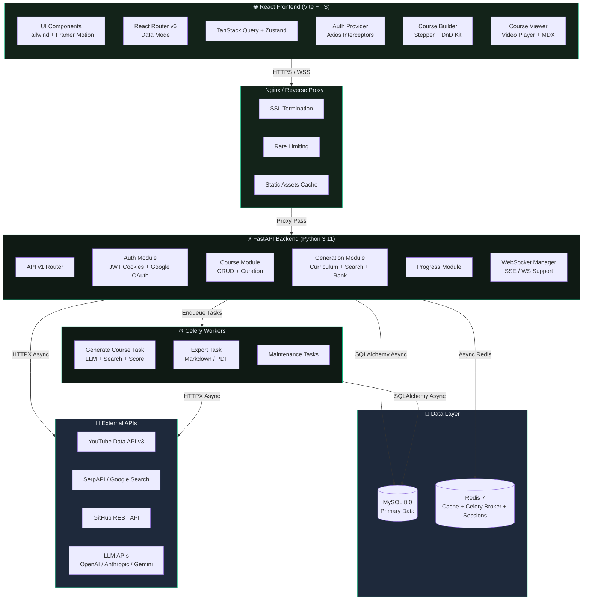

# 🌿 CourseForge — AI-Powered Course Generator

> **Production-grade web application where users describe a learning goal, and AI autonomously curates a structured, mastery-driven curriculum from the world's best YouTube tutorials, open-source repositories, and official documentation.**

Designed with **Linear/Apple/Stripe-level visual excellence**, featuring an emerald **Deep Forest → Neon Canopy** palette, fluid **Framer Motion** physics, and zero jank.

---

## 🏛️ System Architecture



---

## ✨ Key Capabilities

1. **Autonomous 4-Stage Generation Pipeline**:
   - **Stage 1 (Planning)**: LLM Curriculum Architect generates pedagogical modules and search queries.
   - **Stage 2 (Parallel Search)**: Searches YouTube Data API v3, GitHub, and DevDocs in parallel.
   - **Stage 3 (Scoring & Ranking)**: Applies channel diversity, views/quality weighting, and authority signals.
   - **Stage 4 (Persistence)**: Generates normalized data models and denormalized snapshots for ultra-fast reads.
2. **Interactive Live WebSocket Stream**:
   - Real-time pipeline visualizer showing pulsing nodes (`Plan` → `Search` → `Rank` → `Save` → `Done`) and live console logs.
3. **Drag & Drop Syllabus Curation**:
   - Reorder modules, drag lectures, edit titles inline, and customize primary resources using `@dnd-kit/core` & `@dnd-kit/sortable`.
4. **Mastery Learning Cockpit**:
   - Collapsible modules sidebar, integrated video player with synchronized markdown notes and code blocks, keyboard shortcuts (`[J]` Previous, `[K]` Next, `[M]` Complete), and circular SVG progress ring.
5. **Rock-Solid Security**:
   - HttpOnly, SameSite=Lax cookie authentication with automatic access (15m) & refresh (30d) token rotation via Axios interceptors.
6. **MANDATORY Deep Forest → Neon Canopy Green Design System**:
   - Custom OKLCH color tokens, glassmorphism utilities, magnetic button physics, and canvas neural network reactive background.

---

## 🚀 Quickstart with Docker Compose

To launch the complete production stack (Backend, Frontend, MySQL 8, Redis 7, Celery Worker, Mailhog):

```bash
# 1. Clone & copy environment variables
cp .env.example .env

# 2. Build and start all services
docker compose up --build
```

Access the services:
- **Frontend Web App**: [http://localhost:5173](http://localhost:5173)
- **FastAPI Backend Swagger**: [http://localhost:8000/docs](http://localhost:8000/docs)
- **Mailhog Web UI**: [http://localhost:8025](http://localhost:8025)

---

## 🛠️ Standalone Local Development

### 1. Backend Setup (`fastapi_backend/`)

```bash
cd fastapi_backend

# Create virtual environment
python3 -m venv venv
source venv/bin/activate

# Install dependencies
pip install -r requirements.txt

# Run migrations (or start app with automatic SQLite fallback schema init)
uvicorn app.main:app --host 0.0.0.0 --port 8000 --reload
```

Run tests:
```bash
pytest -v
```

### 2. Frontend Setup (`react_frontend/`)

```bash
cd react_frontend

# Install dependencies
npm install

# Start Vite dev server with Hot Module Replacement
npm run dev
```

Build for production:
```bash
npm run build
```

---

## ⌨️ Course Viewer Hotkeys

| Key | Action | Toast Feedback |
| :--- | :--- | :--- |
| `J` | Jump to Previous Lesson | Auto-focuses lesson |
| `K` | Advance to Next Lesson | Smooth transition |
| `M` | Toggle Completion Status | *"Marked Complete ✨"* |

---

## 📁 Repository Structure

```
Course_Builder/
├── docker-compose.yml          # Full multi-container composition
├── .env.example                # Canonical environment template
├── README.md                   # Documentation & architecture
├── fastapi_backend/            # FastAPI Python 3.11+ ASGI Service
│   ├── app/
│   │   ├── main.py             # Entrypoint, CORS, WebSockets
│   │   ├── core/               # Config, Database, Security, Celery
│   │   ├── models/             # SQLAlchemy 2.0 Async Models
│   │   ├── schemas/            # Pydantic v2 Request/Response
│   │   ├── api/v1/             # Auth, Users, Courses, Resources, Progress
│   │   ├── services/           # AI, Search, Scoring, Export
│   │   └── tasks/              # Celery Tasks & Live Broadcaster
│   ├── alembic/                # Database Migrations
│   ├── tests/                  # Pytest test suite
│   ├── requirements.txt
│   └── Dockerfile
└── react_frontend/             # React 18 + Vite + TypeScript + Tailwind
    ├── src/
    │   ├── routes/             # Landing, Auth, Dashboard, Builder, Course Viewer
    │   ├── components/ui/      # Button, Card, Input, ProgressRing, MagneticButton
    │   ├── components/background/ # CanvasNeuralNet, FloatingOrbs
    │   ├── components/layout/  # Navbar, Sidebar, Footer, PageTransition
    │   ├── hooks/              # useAuth, useCourses, useWebSocket
    │   ├── lib/                # api.ts (401 interceptor), motion.ts, validations.ts
    │   └── styles/             # globals.css (OKLCH green tokens), animations.css
    ├── tailwind.config.ts      # Mandatory Emerald/Green Theme Config
    ├── package.json
    └── Dockerfile
```
